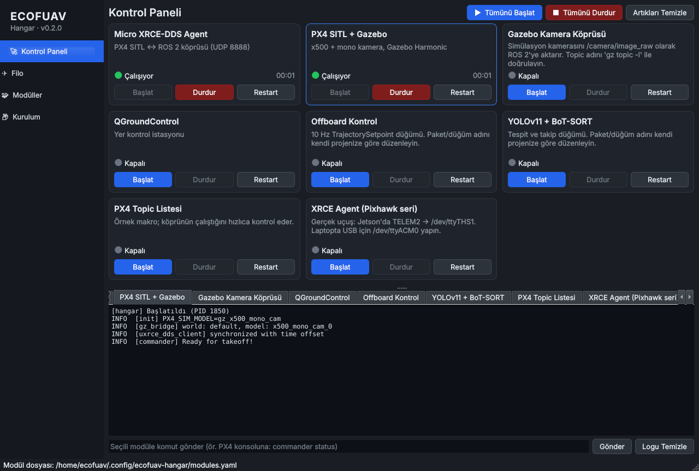
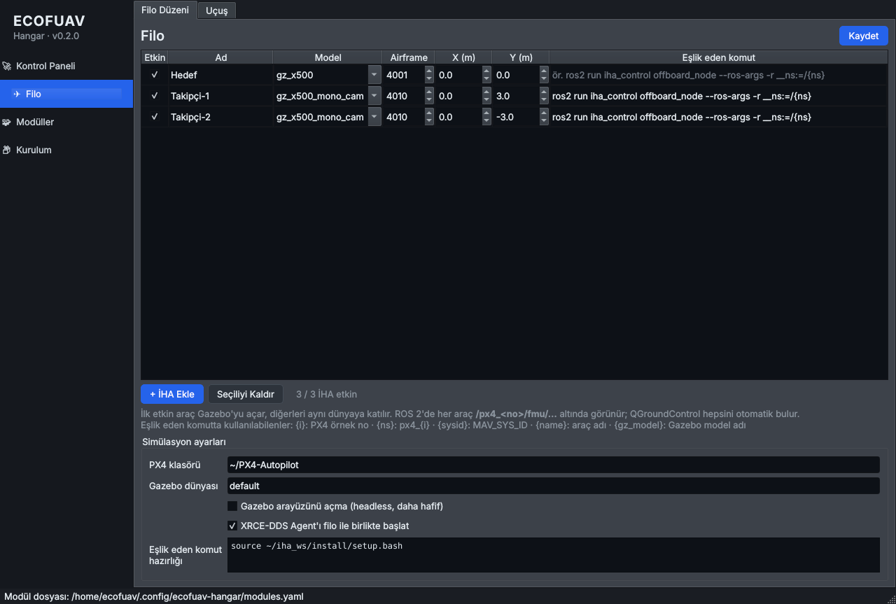
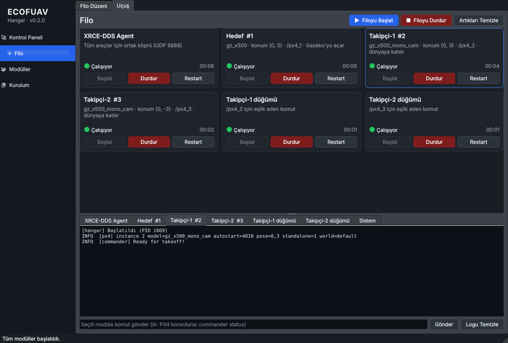
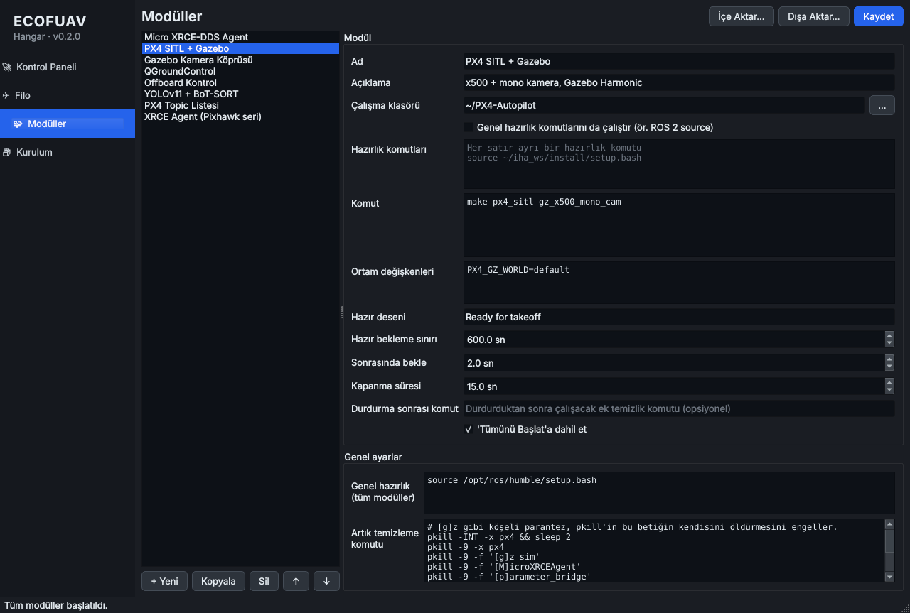
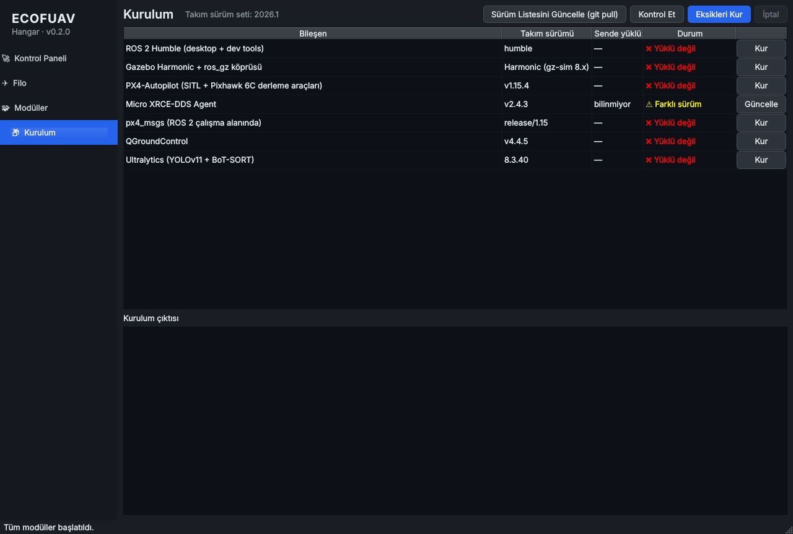

# ECOFUAV Hangar — Kullanım Kılavuzu

Bu kılavuz ECOFUAV Hangar'ın her ekranını, her butonunu ve her ayarını anlatır. Baştan sona
okumak zorunda değilsiniz: yeni başlıyorsanız **1–3. bölümler** yeterli, bir şeyi nasıl
yapacağınızı arıyorsanız **9. bölümdeki tariflere**, bir sorun yaşıyorsanız **10. bölüme** bakın.

## İçindekiler

1. [Hangar nedir, ne işe yarar?](#1-hangar-nedir-ne-işe-yarar)
2. [Kurulum ve ilk açılış](#2-kurulum-ve-ilk-açılış)
3. [Ekranın genel düzeni](#3-ekranın-genel-düzeni)
4. [Kontrol Paneli](#4-kontrol-paneli)
5. [Filo (çoklu İHA simülasyonu)](#5-filo-çoklu-iha-simülasyonu)
6. [Modüller (modül ve makro ekleme)](#6-modüller-modül-ve-makro-ekleme)
7. [Kurulum sayfası (takım sürümleri)](#7-kurulum-sayfası-takım-sürümleri)
8. [Uygulamayı kapatmak](#8-uygulamayı-kapatmak)
9. [Adım adım tarifler](#9-adım-adım-tarifler)
10. [Sorun giderme](#10-sorun-giderme)
11. [Dosyalar nerede durur?](#11-dosyalar-nerede-durur)
12. [Takım sürümünü yönetmek (sorumlu kişi için)](#12-takım-sürümünü-yönetmek-sorumlu-kişi-için)
13. [Terimler sözlüğü](#13-terimler-sözlüğü)

---

## 1. Hangar nedir, ne işe yarar?

Geliştirme sırasında her seferinde 4–5 terminal açıp `source` yazmak, `make px4_sitl ...`
çalıştırmak, kapanmayan Gazebo'yu `killall` ile öldürmek yerine hepsini tek pencereden yönetirsiniz.

Hangar üç işi yapar:

| İş | Nerede |
|---|---|
| Gazebo, PX4 SITL, XRCE-DDS Agent, ROS 2 düğümleri, QGroundControl gibi programları **başlatmak, durdurmak, yeniden başlatmak** ve çıktılarını izlemek | Kontrol Paneli |
| Aynı simülasyonda **birden fazla İHA** uçurmak (ör. 1 hedef + 2 takipçi) | Filo |
| Kendi komutlarınızı / makrolarınızı **eklemek** | Modüller |
| Takımdaki herkesin **aynı sürümleri** kurmasını sağlamak | Kurulum |

Hedef sistem **Ubuntu 22.04 + ROS 2 Humble**'dır. Windows'ta yalnızca WSL2 içinde çalışır
(bkz. [2.4](#24-windowsta-wsl2-ile-kullanım)).

---

## 2. Kurulum ve ilk açılış

### 2.1 Hangar'ı kurmak

Terminalde (bu, terminal kullanacağınız son yerlerden biri):

```bash
git clone https://github.com/furkannpala/ecofuav-hangar.git ~/ecofuav-hangar
cd ~/ecofuav-hangar
./setup.sh
```

`setup.sh` şunları yapar:

1. Gerekli sistem paketlerini kurar (`python3-venv`, `python3-pip`, `libxcb-cursor0`, `git`).
   Bu adımda **sudo şifreniz** sorulur.
2. Proje klasöründe `.venv` adında ayrı bir Python ortamı oluşturur ve PySide6 ile PyYAML'ı
   oraya kurar. Sistemdeki Python paketlerinize dokunmaz; ROS 2'yi bozmaz.
3. İki kısayol oluşturur:
   - `~/.local/bin/ecofuav-hangar` → terminalden `ecofuav-hangar` yazarak açmak için
   - `~/.local/share/applications/ecofuav-hangar.desktop` → uygulama menüsünde
     **ECOFUAV Hangar** simgesi

> `ecofuav-hangar` komutu "bulunamadı" derse oturumu kapatıp açın; `~/.local/bin` yeni
> oluşturulduysa PATH'e ancak yeni oturumda eklenir.

### 2.2 Uygulamayı açmak

- **Uygulama menüsünden:** Etkinlikler / Uygulamalar → *ECOFUAV Hangar*
- **Terminalden:** `ecofuav-hangar`
- **Geliştirme yaparken:** proje klasöründe `.venv/bin/python main.py`

Terminalden açtıysanız terminalde **Ctrl+C**'ye basmak, pencereyi kapatmakla aynı şeyi yapar
(bkz. [8. bölüm](#8-uygulamayı-kapatmak)): çalışan modülleri düzgünce durdurmayı teklif eder.

### 2.3 İlk açılışta ne olur?

- `~/.config/ecofuav-hangar/modules.yaml` yoksa, takımın hazırladığı varsayılan modül listesi
  (`config/default_modules.yaml`) oraya kopyalanır. Bundan sonra **sizin kopyanız** kullanılır;
  yaptığınız değişiklikler başkalarını etkilemez.
- Filo için kayıtlı ayar yoksa varsayılan 3 araçlık filo gösterilir (Hedef + Takipçi-1 + Takipçi-2).
  Siz **Kaydet**'e basana kadar `fleet.yaml` dosyası oluşturulmaz.
- Kurulum sayfası arka planda hangi bileşenlerin yüklü olduğunu kontrol eder.

**Yeni bir bilgisayarda önerilen sıra:** önce **Kurulum** sayfasından eksikleri kurun
([7. bölüm](#7-kurulum-sayfası-takım-sürümleri)), sonra Kontrol Paneli'ne geçin.

### 2.4 Windows'ta (WSL2 ile) kullanım

Gazebo, PX4 ve ROS 2 Windows'ta doğrudan çalışmaz; Hangar da Windows'ta açılmaz
("yalnızca Linux'ta (veya Windows'ta WSL2 içinde) çalışır" mesajı verip kapanır).
Windows 11'de:

1. PowerShell'i **yönetici olarak** açın: `wsl --install -d Ubuntu-22.04`
2. Bilgisayarı yeniden başlatın, açılan Ubuntu penceresinde kullanıcı adı/şifre belirleyin.
3. Ubuntu terminalinde [2.1](#21-hangarı-kurmak)'deki adımları uygulayın.

Pencereler (Hangar, Gazebo, QGC) Windows masaüstünde normal pencere olarak açılır (WSLg).
Kısıtlar: Gazebo daha yavaştır; Pixhawk'ı USB ile bağlamak için `usbipd-win` gerekir.
Kalıcı geliştirme için gerçek Ubuntu (dual-boot) önerilir.

---

## 3. Ekranın genel düzeni



| Bölge | Ne var? |
|---|---|
| **Sol üst** | Takım adı, uygulama adı ve sürümü (ör. *Hangar · v0.2.0*) |
| **Sol menü** | Dört sayfa: **Kontrol Paneli**, **Filo**, **Modüller**, **Kurulum**. Tıklayarak geçilir. Sayfa değiştirmek çalışan hiçbir şeyi durdurmaz. |
| **Sağ taraf** | Seçili sayfanın içeriği |
| **En alt satır (durum çubuğu)** | Kısa bilgi mesajları: "'PX4 SITL + Gazebo' hazır.", "Modüller kaydedildi." gibi. Mesajlar ~8 saniye sonra kaybolur. Açılışta modül dosyasının yolunu gösterir. |

### 3.1 Modül durumları (renkli nokta)

Her modül kartında ve filo kartında şu durumlardan biri görünür:

| Görünüm | Anlamı |
|---|---|
| ⚪ **Kapalı** (gri) | Çalışmıyor. Hiç başlatılmadı, durduruldu ya da kendiliğinden **başarıyla** (çıkış kodu 0) bitti. |
| 🟡 **Başlıyor…** (sarı) | Başlatıldı ama modülün *hazır deseni* henüz çıktıda görülmedi (ör. PX4 hâlâ "Ready for takeoff" yazmadı). Hazır deseni olmayan modüller bu durumu atlayıp doğrudan *Çalışıyor*'a geçer. |
| 🟢 **Çalışıyor** (yeşil) | Çalışıyor ve (varsa) hazır. Sağda çalışma süresi görünür (`dk:sn` ya da `sa:dk:sn`). |
| 🟡 **Durduruluyor…** (sarı) | Durdurma sinyalleri gönderiliyor; bkz. [4.3](#43-durdurma-tam-olarak-nasıl-çalışır). |
| 🔴 **Hata ile kapandı** (kırmızı) | Siz durdurmadan, **sıfırdan farklı** çıkış koduyla kapandı. Nedenini o modülün log sekmesinde görürsünüz. |

---

## 4. Kontrol Paneli

Günlük işin yapıldığı sayfa. Üstte toplu işlem butonları, ortada modül kartları, altta log paneli
vardır. Kartlarla log paneli arasındaki **noktalı çizgiyi** sürükleyerek alanları büyütüp
küçültebilirsiniz.

### 4.1 Üst butonlar

| Buton | Ne yapar? |
|---|---|
| **▶ Tümünü Başlat** | *"Tümünü Başlat'a dahil et"* işaretli modülleri **listedeki sırayla** tek tek başlatır. Ayrıntılar aşağıda. Sıra devam ederken buton soluk (tıklanamaz) olur. |
| **■ Tümünü Durdur** | Devam eden toplu başlatmayı iptal eder ve çalışan **bütün** modülleri durdurur (sondan başa doğru, aynı anda). |
| **Artıkları Temizle** | Hangar dışında açılıp asılı kalmış süreçleri zorla öldürür (`px4`, `gz sim`, `MicroXRCEAgent`, `parameter_bridge`, `QGroundControl`). Önce çalıştırılacak komutları gösteren bir onay penceresi açılır. Çıktısı log panelindeki **Sistem** sekmesinde görünür. Komutu *Modüller → Genel ayarlar*'dan değiştirebilirsiniz. |

**Tümünü Başlat sırası nasıl ilerler?** Her modül için:

1. Modül zaten çalışıyorsa yeniden başlatılmaz, olduğu gibi kullanılır.
2. Modülün **hazır deseni** varsa, çıktıda o desen görülene kadar beklenir
   (durum çubuğunda *"'PX4 SITL + Gazebo' hazır olması bekleniyor…"*).
   - Desen görülünce: *"… hazır."* → sonraki adıma geçilir.
   - **Hazır bekleme sınırı** dolarsa: *"… N sn içinde hazır olmadı, devam ediliyor."* → yine de devam edilir.
   - Modül beklerken kapanırsa (hata ya da normal çıkış): *"… hazır olmadan kapandı, toplu başlatma durduruldu."* → sıra **durur**, kalan modüller başlatılmaz.
3. Modülün **Sonrasında bekle** süresi kadar beklenir, sonra sıradaki modüle geçilir.
4. Bir modül hiç başlatılamazsa (ör. komut boş) sıra durur.

Hepsi bitince: *"Tüm modüller başlatıldı."*

Varsayılan sıra: **Micro XRCE-DDS Agent → PX4 SITL + Gazebo (hazır olana kadar bekler) →
Gazebo Kamera Köprüsü → QGroundControl**. *Offboard Kontrol*, *YOLOv11 + BoT-SORT*,
*PX4 Topic Listesi* ve *XRCE Agent (Pixhawk seri)* varsayılan olarak toplu başlatmaya dahil
değildir; kartlarından tek tek başlatılır.

### 4.2 Modül kartı

Her kartta:

- **Başlık:** modülün adı
- **Açıklama:** modülün açıklaması; açıklama boşsa komutun ilk satırı. Fareyi üzerine getirince
  komutun tamamı ipucu olarak görünür.
- **Durum ve çalışma süresi:** bkz. [3.1](#31-modül-durumları-renkli-nokta)
- **Başlat** (mavi): modülü başlatır. Modül çalışırken soluktur.
- **Durdur** (kırmızı): modülü durdurur. Modül kapalıyken ya da zaten durdurulurken soluktur.
- **Restart:** çalışıyorsa önce durdurur, tamamen kapanınca **en güncel ayarlarla** yeniden başlatır.
  Kapalıysa doğrudan başlatır. Yalnızca *Durduruluyor…* sırasında soluktur.

**Karta tıklamak** (butonların dışında bir yere) kartı mavi çerçeveyle seçer ve alttaki log
panelinde o modülün sekmesini açar.

### 4.3 Durdurma tam olarak nasıl çalışır?

Gazebo, PX4 ve `ros2 launch` arkada çok sayıda alt süreç açar. Hangar her modülü kendi
**süreç grubunda** başlatır ve durdururken grubun **tamamına** sinyal gönderir. Böylece arkada
`gz sim` ya da `px4` kalmaz. Sıra şöyledir (her adım log'a yazılır):

1. **SIGINT** gönderilir (terminalde Ctrl+C'ye basmakla aynı). Programlar düzgünce kapanma
   fırsatı bulur. Modülün **Kapanma süresi** kadar beklenir (PX4 için 15 sn, varsayılan 10 sn).
2. Hâlâ kapanmadıysa **SIGTERM**, 3 sn beklenir.
3. Hâlâ kapanmadıysa **SIGKILL** (zorla öldürme), 2 sn beklenir. Bunda da kapanmazsa log'a
   *"UYARI: Süreç grubu SIGKILL sonrası da kapanmadı."* yazılır.
4. Modülün **Durdurma sonrası komutu** varsa çalıştırılır (en fazla 30 sn; çıktısı log'a yazılır).
5. *"Durduruldu."* → durum **Kapalı**.

**Önemli ayrıntı:** Modülün ana komutu bitse bile aynı gruptaki başka bir süreç (ör. arka planda
açılmış bir program) çalışmaya devam ediyorsa, modül **Çalışıyor** görünmeye devam eder ve log'a
*"Ana komut bitti ama gruptaki süreçler hâlâ çalışıyor."* yazılır. Durdur'a basınca hepsi kapatılır.

### 4.4 Log paneli

- Her modülün **ayrı bir sekmesi** vardır; sekmeler modül sırasıyla dizilir. En sondaki
  **Sistem** sekmesi *Artıkları Temizle* çıktısı içindir.
- Hangar'ın kendi mesajları `[hangar]` ile başlar: başlatıldı (PID ile), sinyal gönderiliyor,
  süreç sonlandı (çıkış kodu ile), durduruldu, hazırlık komutu başarısız vb.
- Programların hem normal çıktısı hem hata çıktısı aynı sekmede görünür.
- Renk kodları temizlenir; ilerleme çubukları gibi satır içi güncellemeler ayrı satırlar olarak görünür.
- Her sekme **en son 5000 satırı** tutar; daha eskiler silinir.
- En alttaysanız yeni satırlar geldikçe otomatik kayar. Yukarı kaydırıp eski bir satırı
  okurken kayma durur; tekrar en alta indiğinizde devam eder.
- Metni seçip **Ctrl+C** ile kopyalayabilirsiniz.

**Alttaki satır:**

| Öğe | Ne yapar? |
|---|---|
| **Komut kutusu** | Yazdığınız metin, **açık olan sekmedeki** modülün standart girdisine (stdin) gönderilir. Enter'a basmak ya da **Gönder** aynı şeydir. Gönderilen satır log'da `> metin` olarak görünür. En çok PX4 konsolu (`pxh>`) için kullanılır: `commander status`, `commander arm`, `listener vehicle_status`, `param show MPC_*` gibi. Modül çalışmıyorsa *"Modül çalışmıyor, komut gönderilemedi."* yazılır. |
| **Gönder** | Komut kutusundakini gönderir. |
| **Logu Temizle** | Yalnızca açık sekmenin ekranını temizler; modülü etkilemez, dosyaya kaydedilmiş bir şey silinmez. |

### 4.5 Varsayılan modüller

| Modül | Komut | Ne zaman kullanılır? |
|---|---|---|
| **Micro XRCE-DDS Agent** | `MicroXRCEAgent udp4 -p 8888` | Simülasyonda PX4 ↔ ROS 2 köprüsü. PX4'ten **önce** açılır. |
| **PX4 SITL + Gazebo** | `make px4_sitl gz_x500_mono_cam` (`~/PX4-Autopilot` içinde) | Tek araçlık simülasyon. Kameralı x500 ile Gazebo Harmonic'i açar. "Ready for takeoff" görülünce hazır sayılır. İlk çalıştırmada derleme yapabileceği için bekleme sınırı 600 sn'dir. |
| **Gazebo Kamera Köprüsü** | `ros2 run ros_gz_bridge parameter_bridge ...` | Simülasyon kamerasını `/camera/image_raw` olarak ROS 2'ye aktarır (YOLO düğümü bunu okur). Topic adı modele göre değişebilir; simülasyon açıkken `gz topic -l` ile kontrol edin. |
| **QGroundControl** | `~/QGroundControl.AppImage` | Yer kontrol istasyonu. |
| **Offboard Kontrol** | `ros2 run iha_control offboard_node` | **Yer tutucu.** Kendi paket/düğüm adınızla değiştirin. |
| **YOLOv11 + BoT-SORT** | `ros2 run iha_vision tracker_node` | **Yer tutucu.** Kendi paket/düğüm adınızla değiştirin. |
| **PX4 Topic Listesi** | `ros2 topic list \| grep /fmu/` | Örnek makro: köprünün çalışıp çalışmadığını hızlıca gösterir. Tek seferlik çalışır, bitince *Kapalı* olur (bu normal). |
| **XRCE Agent (Pixhawk seri)** | `MicroXRCEAgent serial --dev /dev/ttyTHS1 -b 921600` | **Gerçek uçuş** için. Jetson Orin NX'te Pixhawk 6C'nin TELEM2'sine bağlı seri port. Laptopta USB için `/dev/ttyACM0` yapın. Simülasyon Agent'ı ile aynı anda çalıştırmayın. |

> "ROS 2'yi source et" adımı (`source /opt/ros/humble/setup.bash`) **Genel hazırlık** olarak
> tanımlıdır ve "Genel hazırlık komutlarını da çalıştır" işaretli tüm modüllerde otomatik yapılır.
> Agent, PX4 ve QGC'de bu işaret kapalıdır (ihtiyaçları yok).

---

## 5. Filo (çoklu İHA simülasyonu)

Aynı Gazebo dünyasında birden fazla aracı birlikte uçurmak için. Otonom takip görevini (hedef +
takipçiler) simülasyonda denemenin yolu budur. Sayfanın üstünde iki sekme vardır:
**Filo Düzeni** (araçları tanımlarsınız) ve **Uçuş** (çalıştırırsınız).

### 5.1 Nasıl çalışır?

- **Tek** bir XRCE-DDS Agent bütün araçlara hizmet eder.
- Listedeki **ilk etkin araç** Gazebo'yu açar. Diğerleri aynı dünyaya **katılır**
  (`PX4_GZ_STANDALONE=1`).
- Her araç bir **örnek numarası** alır: etkin araçlar yukarıdan aşağı **1, 2, 3…** diye
  numaralanır.

| Örnek no (`{i}`) | ROS 2 isim alanı (`{ns}`) | MAVLink sistem kimliği (`{sysid}`) | Gazebo model adı (`{gz_model}`) |
|---|---|---|---|
| 1 | `/px4_1/fmu/...` | 2 | ör. `x500_1` |
| 2 | `/px4_2/fmu/...` | 3 | ör. `x500_mono_cam_2` |
| 3 | `/px4_3/fmu/...` | 4 | ör. `x500_mono_cam_3` |

- QGroundControl bütün araçları kendiliğinden bulur; üstteki araç seçiciden aralarında geçiş yapılır.

> **Dikkat:** Numaralar **etkin araçların sırasına** göre verilir. Bir aracın *Etkin*
> işaretini kaldırırsanız ya da sırayı değiştirirseniz alttaki araçların numarası (ve ROS isim
> alanı) değişir. Kodunuzda isim alanını sabit yazdıysanız bunu göz önünde bulundurun.

### 5.2 Filo Düzeni sekmesi



**Araç tablosu** — her satır bir İHA'dır. Hücrelere doğrudan tıklayıp düzenlersiniz:

| Sütun | Açıklama |
|---|---|
| **Etkin** | İşaretsiz araçlar tabloda kalır ama simülasyona katılmaz. Bir aracı silmeden geçici olarak çıkarmak için kullanın. |
| **Ad** | Kartlarda ve log sekmelerinde görünen ad (ör. *Hedef*, *Takipçi-1*). Boş bırakılırsa `İHA-<satır no>` olur. |
| **Model** | PX4 Gazebo modeli. Listeden seçin ya da elle yazın. Hazır seçenekler: `gz_x500` (dört pervaneli), `gz_x500_mono_cam` (kameralı x500), `gz_x500_depth` (derinlik kameralı), `gz_x500_vision` (görsel odometri), `gz_rc_cessna` (sabit kanat), `gz_standard_vtol` (VTOL). |
| **Airframe** | PX4'ün `SYS_AUTOSTART` numarası. Listeden model seçince **kendiliğinden** dolar (4001, 4010, 4002, 4005, 4003, 4004). Listede olmayan bir model yazarsanız numarayı elle girin (PX4'te `ROMFS/px4fmu_common/init.d-posix/airframes/` klasörüne bakın). |
| **X (m), Y (m)** | Aracın Gazebo'daki başlangıç konumu (metre, −1000…1000, 0,1 hassasiyet). **Araçları aynı noktaya koymayın**; çarpışarak doğarlar. Aralarında en az 2–3 m bırakın. |
| **Eşlik eden komut** | İsteğe bağlı. Araçla birlikte başlatılacak ROS 2 komutu (ör. o aracın offboard ya da takip düğümü). Aşağıdaki yer tutucuları kullanabilirsiniz. Boş bırakılırsa araca düğüm açılmaz. |

**Eşlik eden komuttaki yer tutucular:**

| Yazdığınız | Yerine gelen | Örnek |
|---|---|---|
| `{i}` | Örnek numarası | `2` |
| `{ns}` | ROS 2 isim alanı (başında `/` yok) | `px4_2` |
| `{sysid}` | MAVLink sistem kimliği | `3` |
| `{name}` | Aracın adı | `Takipçi-1` |
| `{gz_model}` | Gazebo'daki model adı (kamera topic'i kurarken işe yarar) | `x500_mono_cam_2` |

Örnek:
```
ros2 run iha_control offboard_node --ros-args -r __ns:=/{ns} -p target_ns:=/px4_1
```
Bash'teki `${DEGISKEN}` gibi ifadeler bozulmaz; yalnızca yukarıdaki beş kelime değiştirilir.

**Tablonun altındaki butonlar:**

| Buton | Ne yapar? |
|---|---|
| **+ İHA Ekle** | Tablonun sonuna yeni bir araç ekler. Adı `İHA-<no>` olur. Model, airframe, X ve eşlik eden komut **son satırdan kopyalanır**. Y konumu sırayla +3, −3, +6, −6… m verilir ki araçlar üst üste doğmasın. |
| **Seçiliyi Kaldır** | Önce tablodan bir satıra tıklayın, sonra basın; onay sorulur. |
| *"3 / 3 İHA etkin"* | Etkin / toplam araç sayısı. 5'ten fazla etkin araçta laptopun yavaşlayabileceği uyarısı çıkar. |

**Simülasyon ayarları:**

| Ayar | Açıklama |
|---|---|
| **PX4 klasörü** | PX4-Autopilot'un yeri. Varsayılan `~/PX4-Autopilot`. |
| **Gazebo dünyası** | `PX4_GZ_WORLD` değeri. Varsayılan `default`. PX4'ün `Tools/simulation/gz/worlds/` klasöründeki başka bir dünyanın adını yazabilirsiniz. |
| **Gazebo arayüzünü açma (headless)** | İşaretlenirse Gazebo penceresi açılmaz; simülasyon arkada çalışır. Çok araçla daha akıcı olur. Takibi QGC ve RViz üzerinden izlersiniz. |
| **XRCE-DDS Agent'ı filo ile birlikte başlat** | Varsayılan açık. Kapatırsanız Agent'ı kendiniz (ör. Kontrol Paneli'nden) açmalısınız. |
| **Eşlik eden komut hazırlığı** | Eşlik eden komutlardan önce çalışacak satırlar (her satır ayrı). Varsayılan: `source ~/iha_ws/install/setup.bash`. Genel hazırlık (ROS 2 source) bunlardan önce zaten otomatik yapılır. |

**Kaydet** (sağ üst): ayarları `~/.config/ecofuav-hangar/fleet.yaml` dosyasına yazar ve Uçuş
sekmesindeki kartları günceller. Kaydedilmemiş değişiklik varken başlığın yanında
*"● Kaydedilmemiş değişiklikler var"* yazar.
**Çalışan araçlar yeni ayarları ancak Restart sonrası kullanır.**

### 5.3 Uçuş sekmesi



Kontrol Paneli ile aynı şekilde çalışır (kartlar, log sekmeleri, komut kutusu,
*Artıkları Temizle*). Farkları:

- Kartlar filodan **otomatik** üretilir; sırası: **XRCE-DDS Agent → araçlar (#1, #2, …) →
  eşlik eden düğümler**.
- Araç kartının açıklaması: model · konum · ROS isim alanı · *"Gazebo'yu açar"* ya da
  *"dünyaya katılır"*.
- Kart adları `Ad  #örnek no` biçimindedir (ör. *Takipçi-1  #2*).

**▶ Filoyu Başlat** basınca:

1. Kaydedilmemiş değişiklik varsa *"Kaydedip başlatılsın mı?"* diye sorar.
2. Etkin araç yoksa uyarır ve durur.
3. **Kontrol Paneli'nde çalışan modül varsa** listesini gösterip sorar, çünkü tek araçlık PX4
   SITL ya da ikinci bir Agent filoyla çakışır:
   - **Evet:** Kontrol Paneli'ndekileri durdurur, tamamen kapanmalarını bekler (en fazla 30 sn),
     sonra filoyu başlatır.
   - **Hayır:** onlara dokunmadan filoyu yine de başlatır (ne yaptığınızı biliyorsanız).
   - **İptal:** hiçbir şey yapmaz.
4. Agent → 1 sn bekle → **araç #1** (PX4 henüz derlenmemişse önce derler; Gazebo'yu açar;
   "Ready for takeoff" için en fazla 600 sn bekler) → 1 sn → **araç #2** (en fazla 120 sn bekler)
   → … → eşlik eden düğümler.

**■ Filoyu Durdur** tüm filo modüllerini durdurur.

**Tek bir aracı** kartındaki butonlarla durdurup yeniden başlatabilirsiniz. Ancak:

> **Araç #1'i durdurmak Gazebo'yu da kapatır** (Gazebo'yu o açtı). Diğer araçlar simülasyonsuz
> kalır. Araç #1'i yeniden başlatmak yerine **Filoyu Durdur → Filoyu Başlat** yapın.

### 5.4 Kaç araç uçurabilirim?

Sınır yoktur; sınırı bilgisayarınız belirler. Her araç ayrı bir PX4 süreci ve Gazebo'da bir
model demektir. Laptopta 3–4 araç rahattır; 5'ten sonrası yavaşlayabilir. Yavaşlarsa
**headless** seçeneğini açın, kamera modeli gerekmeyen araçlarda `gz_x500` kullanın.

---

## 6. Modüller (modül ve makro ekleme)

Kontrol Paneli'ndeki kartları buradan eklersiniz, düzenlersiniz, silersiniz. Bir komutu
"modül" yapmak için tek şart, terminalde çalışan bir komut olması.



### 6.1 Üst butonlar

| Buton | Ne yapar? |
|---|---|
| **İçe Aktar…** | Bir `.yaml` modül dosyası seçtirir ve **mevcut listenin yerine** onu yükler. Henüz kaydedilmez; beğendiyseniz **Kaydet**'e basın, vazgeçtiyseniz sayfadan çıkıp uygulamayı kapatırken *Kaydetme* deyin. |
| **Dışa Aktar…** | Ekrandaki listeyi (kaydedilmemiş değişiklikler dahil) seçtiğiniz bir `.yaml` dosyasına yazar. Takım arkadaşınıza modüllerinizi göndermek için kullanın. |
| **Kaydet** | Değişiklikleri `~/.config/ecofuav-hangar/modules.yaml` dosyasına yazar; Kontrol Paneli **ve** Filo hemen güncellenir. |

Kaydedilmemiş değişiklik varken başlığın yanında *"● Kaydedilmemiş değişiklikler var"* yazar.
Listede başka bir modüle geçmek değişiklikleri **kaybettirmez**; hepsi Kaydet'e basana kadar bellekte durur.

### 6.2 Sol liste ve butonları

| Buton | Ne yapar? |
|---|---|
| **+ Yeni** | Listenin sonuna *"Yeni Modül"* ekler ve Ad kutusunu seçer. Yeni modüller toplu başlatmaya **dahil değildir**. |
| **Kopyala** | Seçili modülün bir kopyasını hemen altına ekler (`… (kopya)`). Benzer bir modül yapmanın en hızlı yolu. |
| **Sil** | Seçili modülü onay sorarak siler. Kaydedildiğinde, modül o sırada çalışıyorsa **durdurulur**. |
| **↑ / ↓** | Seçili modülü yukarı/aşağı taşır. Sıra hem kartların dizilişini hem de **Tümünü Başlat sırasını** belirler. |

### 6.3 Modül formu (her alan)

| Alan | Açıklama | Örnek |
|---|---|---|
| **Ad** | Kartta ve log sekmesinde görünen ad. Yazarken soldaki liste de güncellenir. | `Rosbag Kayıt` |
| **Açıklama** | Kartta adın altında görünen kısa açıklama. Boşsa komutun ilk satırı gösterilir. | `Tüm topic'leri kaydeder` |
| **Çalışma klasörü** | Komut hangi klasörde çalışsın? `~` ve `$DEGISKEN` kullanılabilir. **…** butonu klasör seçtirir. Klasör yoksa modül *"Çalışma klasörü bulunamadı"* deyip hata ile kapanır. | `~/iha_ws` |
| **Genel hazırlık komutlarını da çalıştır** | İşaretliyse aşağıdaki *Genel ayarlar*'daki hazırlık satırları (ROS 2 source) bu modülden önce çalışır. ROS 2 kullanan her modülde açık olmalı. | ✔ |
| **Hazırlık komutları** | Komuttan önce çalışacak satırlar, **her satır ayrı** komut. Biri başarısız olursa (ör. dosya yok) modül *"Hazırlık komutu başarısız: …"* deyip hata ile kapanır; asıl komut hiç çalışmaz. | `source ~/iha_ws/install/setup.bash` |
| **Komut** | Asıl çalışacak komut. Birden fazla satır olabilir; bash betiği gibi çalışır (`&&`, `\|`, döngüler, değişkenler serbest). Boş bırakılırsa modül başlatılamaz. | `ros2 bag record -a -o ~/kayitlar/ucus_$(date +%H%M)` |
| **Ortam değişkenleri** | Her satıra bir `ANAHTAR=DEĞER`. Değerlerde `~` ve `$DEGISKEN` açılır. `=` içermeyen satırlar yok sayılır. | `PX4_GZ_WORLD=default` |
| **Hazır deseni** | Çıktıda bu ifade görülünce modül **hazır** sayılır (*Başlıyor…* → *Çalışıyor*) ve Tümünü Başlat sırası devam eder. Python düzenli ifadesidir (regex), **büyük/küçük harfe duyarlıdır**; düz metin de yazabilirsiniz. Boş bırakılırsa modül başlar başlamaz hazır sayılır. Geçersiz ifade yazılırsa log'a uyarı düşer ve yok sayılır. | `Ready for takeoff` |
| **Hazır bekleme sınırı** | Hazır deseni için en fazla kaç saniye beklensin. Dolarsa Tümünü Başlat uyarıyla devam eder (modül çalışmaya devam eder). | `60 sn` |
| **Sonrasında bekle** | Tümünü Başlat'ta, bu modül başladıktan/hazır olduktan sonra sıradakine geçmeden önce ek bekleme. | `2 sn` |
| **Kapanma süresi** | Durdururken SIGINT'ten sonra SIGTERM'e geçmeden önce ne kadar beklensin (bkz. [4.3](#43-durdurma-tam-olarak-nasıl-çalışır)). Düzgün kapanması uzun süren programlarda artırın. | `10 sn` |
| **Durdurma sonrası komut** | Modül tamamen kapandıktan sonra bir kez çalışacak temizlik komutu. En fazla 30 sn. | `rm -f /tmp/kilit_dosyasi` |
| **'Tümünü Başlat'a dahil et** | İşaretliyse ▶ Tümünü Başlat bu modülü de açar. | ✔ |

Hangar her modüle şu ortam değişkenlerini kendiliğinden ekler (siz aynısını tanımlarsanız
sizinki geçerli olur): `PYTHONUNBUFFERED=1` ve `RCUTILS_LOGGING_BUFFERED_STREAM=1`
(log'lar gecikmeden gelsin diye), `RCUTILS_COLORIZED_OUTPUT=0` (renk kodları gelmesin diye).

### 6.4 Genel ayarlar (tüm modüller için)

| Alan | Açıklama |
|---|---|
| **Genel hazırlık (tüm modüller)** | "Genel hazırlık komutlarını da çalıştır" işaretli **her** modülden ve filonun eşlik eden düğümlerinden önce çalışır. Varsayılan: `source /opt/ros/humble/setup.bash`. |
| **Artık temizleme komutu** | **Artıkları Temizle** butonunun çalıştırdığı komut (Kontrol Paneli ve Filo'da ortak). |

> **pkill ipucu:** Temizleme komutunda `pkill -f 'gz sim'` yerine `pkill -f '[g]z sim'` yazılır.
> Köşeli parantez olmadan pkill, komutu çalıştıran kabuğun kendisini de öldürür.

### 6.5 Kaydettikten sonra ne olur?

- Kontrol Paneli'ndeki kartlar ve log sekmeleri yeni listeye göre yeniden dizilir.
- **Çalışan modüllere dokunulmaz;** yeni ayarlar (komut, ortam değişkeni vb.) ancak o modül
  **Restart** edilince ya da durdurulup başlatılınca kullanılır. Durum çubuğu bunu hatırlatır.
- Silinen modül çalışıyorsa durdurulur.
- Genel hazırlık ve temizleme komutu değiştiyse Filo da güncellenir.

---

## 7. Kurulum sayfası (takım sürümleri)

Takımdaki herkesin aynı sürümlerle çalışması için. Sürümler reponun içindeki
`install/versions.yaml` dosyasında yazar; bu sayfa o listeyi sizin bilgisayarınızla karşılaştırır.



### 7.1 Üst kısım

| Öğe | Ne yapar? |
|---|---|
| *"Takım sürüm seti: 2026.1"* | `versions.yaml`'daki sürüm seti etiketi. Takım arkadaşınızla "hangi setteyiz?" diye konuşurken kullanın. |
| **Sürüm Listesini Güncelle (git pull)** | Hangar klasöründe `git pull --ff-only` çalıştırır ve listeyi yeniden okur. Yalnızca Hangar git ile klonlandıysa görünür. Takım sürümü değiştiğinde ilk basacağınız buton. Kodun kendisi de güncellendiyse değişikliklerin tamamı için uygulamayı kapatıp açın. Yerelde değişiklik yaptıysanız pull başarısız olabilir; çıktıda nedeni yazar. |
| **Kontrol Et** | Bütün bileşenlerin yüklü sürümünü yeniden kontrol eder (arka planda; pencere donmaz). |
| **Eksikleri Kur** | *Güncel* olmayan her şeyi tablodaki sırayla kurar. Her şey güncelse *"Her şey takım sürümüyle aynı."* der. |
| **İptal** | Yalnızca kurulum sürerken aktiftir. O anki kurulumu durdurur ve kuyruğu boşaltır. Yarıda kesilen bir bileşeni sonra tekrar kurun. |

### 7.2 Tablo

| Sütun | Açıklama |
|---|---|
| **Bileşen** | Fareyle üzerine gelince (varsa) açıklaması görünür. |
| **Takım sürümü** | Herkesin kullanması gereken sürüm. |
| **Sende yüklü** | Bilgisayarınızda bulunan sürüm. `—` = bulunamadı. |
| **Durum** | ✅ **Güncel** · ⚠️ **Farklı sürüm** · ❌ **Yüklü değil** · ⏳ **Kuruluyor…** |
| **Buton** | Duruma göre **Kur** / **Güncelle** / **Yeniden Kur**. Yalnızca o bileşeni kurar. |

Bileşenler ve sürümün nasıl kontrol edildiği:

| Bileşen | Takım sürümü | Nasıl kontrol edilir? |
|---|---|---|
| ROS 2 Humble | humble | `/opt/ros/humble/setup.bash` var mı |
| Gazebo Harmonic + ros_gz | gz-sim 8.x | `libgz-sim8` paketinin sürümü |
| PX4-Autopilot | v1.15.4 | `~/PX4-Autopilot` deposunun git etiketi |
| Micro XRCE-DDS Agent | v2.4.3 | `MicroXRCEAgent` komutu var mı + Hangar'ın kurulum kaydı |
| px4_msgs | release/1.15 | `~/iha_ws` içinde derlenmiş mi + git dalı |
| QGroundControl | v4.4.5 | `~/QGroundControl.AppImage` var mı + Hangar'ın kurulum kaydı |
| Ultralytics (YOLOv11 + BoT-SORT) | 8.3.40 | `python3 -c "import ultralytics"` sürümü |

> **"bilinmiyor / ⚠️ Farklı sürüm"** görüyorsanız: o bileşen (ör. XRCE Agent) bilgisayarınızda
> var ama Hangar ile kurulmamış, sürümünü bilemiyor. **Güncelle** derseniz takım sürümüyle
> yeniden kurulur ve bundan sonra doğru görünür.

### 7.3 Kurulum sırasında ne olur?

1. Hangi bileşenlerin kurulacağını listeleyen bir onay penceresi çıkar.
2. Çıktı alttaki **Kurulum çıktısı** alanında canlı akar. Her bileşen
   `========== Ad (sürüm) ==========` başlığıyla, her adım `==> ...` satırıyla başlar.
3. Yönetici izni gereken adımlarda **"Yönetici izni gerekli"** başlıklı bir şifre penceresi
   açılır; Ubuntu kullanıcı şifrenizi girin. Bir kurulum boyunca birkaç kez sorabilir.
   **İptal** ederseniz o bileşenin kurulumu başarısız olur.
4. Bir bileşen başarısız olursa *"… kurulumu başarısız (kod N). Kuyruk durduruldu."* yazar;
   sonrakiler kurulmaz. Hatayı okuyup düzeltin, sonra tekrar deneyin.
5. Kuyruk bitince tablo kendiliğinden yeniden kontrol edilir.

**Önerilen sıra** tablodaki sıradır (ROS 2 → Gazebo → PX4 → Agent → px4_msgs → QGC → YOLO).
*Eksikleri Kur* zaten bu sırayla gider. PX4 kurulumu en uzun adımdır (kaynak kodu indirir,
bağımlılıkları kurar, SITL'i ve Pixhawk 6C firmware'ini derler).

### 7.4 Her bileşenin kurulumu ne yapar?

| Bileşen | Yaptıkları | Dikkat |
|---|---|---|
| **ROS 2 Humble** | Locale ayarı, `universe` deposu, resmi ROS 2 apt deposu, `ros-humble-desktop` + `ros-dev-tools`, `rosdep init/update` | Yalnızca Ubuntu 22.04'te çalışır; başka sürümde baştan durur. |
| **Gazebo Harmonic** | OSRF apt deposu, `gz-harmonic`, ROS 2 yüklüyse `ros-humble-ros-gzharmonic` (ros_gz köprüsü) | ROS 2'den önce kurulursa köprü atlanır; ROS 2'den sonra tekrar çalıştırın. |
| **PX4-Autopilot** | `~/PX4-Autopilot`'u klonlar ya da takım etiketine getirir (alt modüller dahil), `Tools/setup/ubuntu.sh`, SITL derlemesi (`gz_x500_mono_cam`), Pixhawk 6C firmware derlemesi (`px4_fmu-v6c_default`) | Klasörde **commit edilmemiş değişiklik varsa durur**, kaybolmasınlar diye. Önce commit/stash yapın. 6C firmware derlenemezse uyarı verir ama SITL hazır sayılır. Bittikten sonra seri port izni için **oturumu kapatıp açın**. |
| **Micro XRCE-DDS Agent** | `~/.local/src/Micro-XRCE-DDS-Agent`'a takım sürümünü indirir, derler, `/usr/local`'a kurar | Kaynak klasörü her seferinde silinip yeniden indirilir. |
| **px4_msgs** | `~/iha_ws/src/px4_msgs`'i PX4 sürümüne uyan dala getirir, **yalnızca px4_msgs'i** derler | ROS 2 kurulu olmalı. Kendi paketlerinizi derlemez; onları her zamanki gibi `colcon build` ile derleyin. Yerel değişiklik varsa durur. |
| **QGroundControl** | Kullanıcıyı `dialout` grubuna ekler, `modemmanager`'ı kaldırır (Pixhawk bağlantısını bozuyor), gerekli kütüphaneleri kurar, AppImage'ı `~/QGroundControl.AppImage` olarak indirir | `dialout` için **oturumu kapatıp açın**. |
| **Ultralytics** | `python3-pip`, `ultralytics`, `numpy<2` (ROS 2 Humble'ın cv_bridge'i numpy 2 ile çalışmaz), `lap` (BoT-SORT için) — kullanıcıya (`--user`) kurar | PyTorch dahil birkaç GB indirebilir. **Jetson'da çalışmaz**; Jetson'da PyTorch NVIDIA'nın JetPack wheel'lerinden kurulmalı (betik bunu söyleyip durur). |

---

## 8. Uygulamayı kapatmak

Pencerenin çarpısına bastığınızda (ya da terminalden açtıysanız Ctrl+C):

1. **Filoda** kaydedilmemiş değişiklik varsa: *Kaydet / Kaydetme / İptal*.
2. **Modüllerde** kaydedilmemiş değişiklik varsa: *Kaydet / Kaydetme / İptal*.
3. Kontrol Paneli'nde, Filo'da ya da Kurulum'da **çalışan bir şey varsa**:
   *"Hepsi durdurulup çıkılsın mı?"*
   - **Evet:** *"Modüller durduruluyor…"* penceresi çıkar, her şey [4.3](#43-durdurma-tam-olarak-nasıl-çalışır)'teki sırayla durdurulur (en fazla 40 sn beklenir), sonra uygulama kapanır.
   - **İptal:** uygulama açık kalır.

Hangar kapanırken çalışan programları arkada **bırakmaz**. Bir şeyin açık kalmasını
istiyorsanız Hangar'ı da açık bırakın.

---

## 9. Adım adım tarifler

### 9.1 Yeni bilgisayarda sıfırdan başlamak

1. Ubuntu 22.04 kurun.
2. [2.1](#21-hangarı-kurmak)'deki üç komutla Hangar'ı kurun ve açın.
3. **Kurulum** → **Eksikleri Kur** → onaylayın → şifre pencerelerinde şifrenizi girin.
   (Uzun sürer; kahvenizi alın.)
4. Kurulum bitince **oturumu kapatıp açın** (`dialout` izni için).
5. Hangar'ı açın, **Kurulum** sayfasında her şeyin ✅ olduğunu görün.
6. Kendi ROS 2 paketlerinizi `~/iha_ws/src` altına klonlayıp derleyin:
   `cd ~/iha_ws && colcon build`
7. **Modüller** → *Offboard Kontrol* ve *YOLOv11 + BoT-SORT*'un komutlarını kendi
   paket/düğüm adlarınızla düzeltin → **Kaydet**.

### 9.2 Tek araçla simülasyon

1. **Kontrol Paneli** → **▶ Tümünü Başlat**.
2. Durum çubuğunu izleyin: Agent → PX4 + Gazebo (*hazır olması bekleniyor…* → *hazır*) →
   kamera köprüsü → QGC.
3. Gazebo ve QGC açılır. Kendi düğümlerinizi kartlarından **Başlat** ile açın.
4. PX4 konsolunda komut çalıştırmak için log panelinde **PX4 SITL + Gazebo** sekmesini açın,
   alttaki kutuya `commander status` yazıp Enter'a basın.
5. İş bitince **■ Tümünü Durdur**.

### 9.3 Kendi düğümünüzü değiştirip yeniden denemek

1. Kodu düzenleyin, `colcon build` ile derleyin (terminalde ya da bunun için bir modül yapın, bkz. 9.6).
2. Düğümün kartında **Restart**. Simülasyonun geri kalanı açık kalır.

### 9.4 Hedef + 2 takipçi ile otonom takip denemesi

1. **Filo** → **Filo Düzeni**. Varsayılan filo zaten *Hedef (#1, x500)* +
   *Takipçi-1 (#2, kameralı)* + *Takipçi-2 (#3, kameralı)*.
2. Takipçilerin **Eşlik eden komut** hücresine kendi düğümünüzü yazın, ör.:
   `ros2 run iha_control follower_node --ros-args -r __ns:=/{ns} -p target_ns:=/px4_1`
3. Hedefi de bir düğümle uçuracaksanız Hedef satırına onun komutunu yazın
   (ör. `ros2 run iha_control target_path_node --ros-args -r __ns:=/{ns}`).
4. **Kaydet** → **Uçuş** sekmesi → **▶ Filoyu Başlat**.
5. Kontrol Paneli'nde bir şey çalışıyorsa sorulan soruya **Evet** deyin.
6. QGC'yi Kontrol Paneli'ndeki kartından açın; üstteki araç seçicide 3 araç görünür.
7. ROS 2'de kontrol: yeni bir modül ya da terminalde `ros2 topic list | grep px4_` →
   `/px4_1/fmu/...`, `/px4_2/fmu/...`, `/px4_3/fmu/...`

### 9.5 Filoya 4. aracı eklemek / bir aracı çıkarmak

- **Eklemek:** **+ İHA Ekle** → adını, modelini, konumunu düzenleyin → **Kaydet**.
  Filo çalışıyorsa yeni aracı eklemek için **Filoyu Durdur → Filoyu Başlat**.
- **Geçici çıkarmak:** satırdaki **Etkin** işaretini kaldırın → **Kaydet**.
- **Tamamen silmek:** satıra tıklayın → **Seçiliyi Kaldır** → onay → **Kaydet**.

### 9.6 Yeni bir makro eklemek (ör. workspace derleme, rosbag kayıt)

1. **Modüller** → **+ Yeni**.
2. Örnek — *Workspace Derle*:
   - Ad: `Workspace Derle`
   - Çalışma klasörü: `~/iha_ws`
   - Genel hazırlık: ✔
   - Komut: `colcon build --symlink-install`
   - Tümünü Başlat'a dahil et: ✘
3. Örnek — *Rosbag Kayıt*:
   - Ad: `Rosbag Kayıt`
   - Çalışma klasörü: `~/kayitlar` (önce klasörü oluşturun)
   - Hazırlık: `source ~/iha_ws/install/setup.bash`
   - Komut: `ros2 bag record -a -o ucus_$(date +%Y%m%d_%H%M%S)`
   - Kapanma süresi: `10 sn` (rosbag'in dosyayı düzgün kapatması için SIGINT ile durdurulması önemli; Hangar zaten önce SIGINT gönderir)
4. **Kaydet** → Kontrol Paneli'nde kartı belirir → **Başlat**.

Tek seferlik komutlar (derleme gibi) bitince *Kapalı* olur; hata verirse *Hata ile kapandı*.
Sonucu log sekmesinden okuyun.

### 9.7 Gerçek uçuş (Jetson Orin NX + Pixhawk 6C)

Hangar Jetson'da da çalışır (JetPack 6 = Ubuntu 22.04). Jetson'da:

1. Hangar'ı kurun (`./setup.sh`).
2. **Kurulum** sayfasında ROS 2, Agent ve px4_msgs'i kurun. Gazebo, PX4 SITL ve QGC gerekmez.
   Ultralytics için PyTorch'u NVIDIA'nın JetPack wheel'lerinden kurun (bkz. 7.4).
3. **Modüller**'de simülasyon modüllerinin (*Micro XRCE-DDS Agent*, *PX4 SITL + Gazebo*,
   *Gazebo Kamera Köprüsü*, *QGroundControl*) **Tümünü Başlat'a dahil et** işaretini kaldırın;
   *XRCE Agent (Pixhawk seri)*, kendi kamera sürücünüz (Arducam), *Offboard Kontrol* ve
   *YOLOv11 + BoT-SORT* modüllerini işaretleyin. Seri port farklıysa komutu düzeltin.
4. **Kaydet** → **Tümünü Başlat**.

> Jetson ile laptop için farklı modül listeleri tutmak isterseniz: listeyi hazırlayıp
> **Dışa Aktar** ile `jetson_modules.yaml` olarak kaydedin; gerektiğinde **İçe Aktar** ile yükleyin.

### 9.8 Modüllerimi takım arkadaşıma vermek

**Dışa Aktar…** → dosyayı gönderin → arkadaşınız **İçe Aktar…** → **Kaydet**.
İçe aktarma arkadaşınızın **mevcut listesinin yerine geçer**. Klasör yolları `~` ile yazıldıysa
başka bilgisayarda da çalışır.

### 9.9 Takım sürümü değişti, ne yapmalıyım?

**Kurulum** → **Sürüm Listesini Güncelle (git pull)** → ⚠️ olanları görün →
**Eksikleri Kur**. (PX4 sürümü değiştiyse px4_msgs da birlikte güncellenir; ikisi uyumlu olmalı.)

---

## 10. Sorun giderme

| Belirti | Olası neden | Çözüm |
|---|---|---|
| Uygulama açılmıyor, terminalde `xcb` / `libxcb-cursor` hatası | Qt'nin ihtiyaç duyduğu kütüphane eksik | `sudo apt install libxcb-cursor0` ya da `./setup.sh`'i tekrar çalıştırın. |
| `ecofuav-hangar: command not found` | `~/.local/bin` PATH'te değil | Oturumu kapatıp açın ya da `~/.local/bin/ecofuav-hangar` ile açın. |
| Modül hemen **Hata ile kapandı**, log'da `Hazırlık komutu başarısız: source ...` | Source edilen dosya yok (ROS 2 kurulu değil ya da workspace derlenmemiş) | Kurulum sayfasından ROS 2'yi kurun; workspace için `colcon build`. |
| Log'da `Çalışma klasörü bulunamadı` | Modülün çalışma klasörü yanlış | Modüller → Çalışma klasörünü düzeltin. |
| Log'da `command not found` | Program kurulu değil ya da PATH'te değil | Kurulum sayfasını kontrol edin; komutu tam yoluyla yazın. |
| PX4 sürekli **Başlıyor…**'da kalıyor | İlk çalıştırmada derleme sürüyor ya da PX4 hata verdi | PX4 log sekmesini okuyun. Derleme ise bekleyin (600 sn sınır). |
| PX4 log'unda Gazebo'ya bağlanamama, ya da Gazebo açılmıyor | Önceki çalışmadan kalan Gazebo / PX4 süreci | **Tümünü Durdur** → **Artıkları Temizle** → tekrar başlatın. |
| Agent log'unda port kullanımda hatası | 8888'de başka bir Agent açık (Kontrol Paneli ile Filo aynı anda, ya da dışarıda kalan) | Fazlasını durdurun ya da **Artıkları Temizle**. |
| `ros2 topic list`'te `/fmu/` topic'leri yok | Agent kapalı, PX4 hazır değil ya da px4_msgs sürümü uyumsuz | Agent'ın çalıştığını ve PX4'ün hazır olduğunu kontrol edin; Kurulum'da px4_msgs ✅ olmalı. |
| Topic'ler var ama veri gelmiyor / tip hatası | px4_msgs, PX4 sürümüyle uyuşmuyor | Kurulum → px4_msgs → **Güncelle**, sonra kendi workspace'inizi yeniden derleyin. |
| Kamera görüntüsü gelmiyor | Kamera köprüsündeki Gazebo topic adı yanlış | Simülasyon açıkken terminalde `gz topic -l \| grep image` → doğru adı Modüller'de köprü komutuna yazın. Filoda model adı `{gz_model}` ile değişir. |
| QGC **Hata ile kapandı** | AppImage yok ya da `libfuse2` eksik | Kurulum → QGroundControl → **Kur**. |
| QGC Pixhawk'ı görmüyor | `dialout` izni yeni eklendi | Oturumu kapatıp açın. |
| `cv_bridge` / numpy hatası | numpy 2 kurulu | `pip3 install --user "numpy<2"` (Ultralytics kurulumu bunu zaten yapar). |
| Durdur'a bastım, **Durduruluyor…** uzun sürdü | Program SIGINT ile kapanmadı, Hangar SIGTERM/SIGKILL'e geçti | Normal. Sık oluyorsa o modülün **Kapanma süresi**'ni ayarlayın. |
| Kurulumda şifre penceresi çıkmadı, kurulum hata verdi | Grafik ortam yok (SSH ile bağlısınız) | Kurulumu bilgisayarın başında yapın ya da ilgili betiği terminalden çalıştırın: `REQ_VERSION=... bash install/scripts/<betik>.sh` |
| Kurulum *"commit edilmemiş değişiklikler var"* deyip durdu | PX4 ya da px4_msgs klasöründe yerel değişiklik | `git -C ~/PX4-Autopilot status` ile bakın; `git stash` ya da commit, sonra tekrar. |
| Değişikliklerim çalışan modüle yansımadı | Kaydedilen ayarlar Restart'ta uygulanır | Kartta **Restart**. |
| Filo araçlarının ROS isim alanları değişti | Bir aracı devre dışı bıraktınız ya da sırayı değiştirdiniz | Bkz. [5.1](#51-nasıl-çalışır) — numaralar etkin araç sırasıyla verilir. |
| Simülasyon çok yavaş | Fazla araç / kamera modeli / Gazebo arayüzü | Headless açın, gereksiz araçları devre dışı bırakın, kamerasızlarda `gz_x500` kullanın. |

**Hata bildirirken** ilgili log sekmesindeki metni seçip kopyalayın (Ctrl+A ile tümünü seçebilirsiniz)
ve hangi butona bastığınızı yazın.

---

## 11. Dosyalar nerede durur?

| Dosya / klasör | İçerik |
|---|---|
| `~/.config/ecofuav-hangar/modules.yaml` | **Sizin** modül listeniz (Modüller sayfası buraya yazar). Silerseniz bir sonraki açılışta takımın varsayılanı geri gelir. |
| `~/.config/ecofuav-hangar/fleet.yaml` | **Sizin** filo ayarlarınız. Silerseniz varsayılan 3 araçlık filo geri gelir. |
| `~/.cache/ecofuav-hangar/askpass.sh` | Kurulumdaki şifre penceresini açan küçük yardımcı; otomatik oluşturulur. |
| `~/.local/share/ecofuav-hangar/installed/` | Hangar'ın kurduğu bileşenlerin sürüm kayıtları (Kurulum sayfası okur). |
| `~/.local/bin/ecofuav-hangar`, `~/.local/share/applications/ecofuav-hangar.desktop` | `setup.sh`'in oluşturduğu kısayollar. |
| `<hangar klasörü>/config/default_modules.yaml` | Takımın varsayılan modül listesi (ilk açılışta kopyalanır). |
| `<hangar klasörü>/install/versions.yaml` | Takım sürüm seti. |
| `<hangar klasörü>/install/scripts/*.sh` | Bileşen kurulum betikleri. |

Kurulan programların yerleri: `~/PX4-Autopilot`, `~/iha_ws`, `~/QGroundControl.AppImage`,
`~/.local/src/Micro-XRCE-DDS-Agent` (Agent kaynağı), `/opt/ros/humble`, `/usr/local/bin/MicroXRCEAgent`.

---

## 12. Takım sürümünü yönetmek (sorumlu kişi için)

`install/versions.yaml` dosyası:

```yaml
team_version: "2026.1"           # Kurulum sayfasının üstünde görünen etiket

env:                             # Betiklere ve kontrol komutlarına verilen değişkenler
  PX4_DIR: ~/PX4-Autopilot
  ROS_WS: ~/iha_ws
  QGC_PATH: ~/QGroundControl.AppImage

components:
  - id: px4                      # benzersiz kısa ad
    name: PX4-Autopilot (...)    # tabloda görünen ad
    required: v1.15.4            # "Takım sürümü" sütununda görünen metin
    version: v1.15.4             # betiğe REQ_VERSION olarak verilir
    match: '^v1\.15\.4$'         # (isteğe bağlı) yüklü sürüm bu regex'e uyarsa ✅. Yoksa: version'a birebir eşit mi
    check: git -C "$PX4_DIR" describe --tags ...   # yüklü sürümü ekrana yazan komut
    script: px4.sh               # install/scripts/ altındaki kurulum betiği
    description: ...             # (isteğe bağlı) fareyle üzerine gelince görünen açıklama
```

**Sürüm yükseltmek** (ör. PX4 v1.15.4 → v1.16.0):

1. `px4` bileşeninde `required` ve `version` değerlerini `v1.16.0` yapın.
2. **Unutmayın:** `px4_msgs` bileşenini de uyumlu dala getirin (`release/1.16`).
3. `team_version`'ı artırın (ör. `"2026.2"`).
4. Kendi bilgisayarınızda Kurulum sayfasından deneyin.
5. Commit + push. Takıma "Sürüm Listesini Güncelle → Eksikleri Kur" deyin.

**Yeni bileşen eklemek:**

1. `install/scripts/` altına betik yazın. İlk satırı `source "$(dirname "$0")/common.sh"`
   olsun. Böylece şunları hazır kullanırsınız:
   - `$REQ_VERSION` — istenen sürüm
   - `step "mesaj"` — log'a `==> mesaj` başlığı yazar
   - `sudo ...` — grafik şifre penceresiyle çalışır
   - `git_checkout <url> <klasör> <tag/dal> [--recursive]` — klonlar ya da günceller, yerel değişiklik varsa durur
   - `mark_installed <id> <sürüm>` — Hangar'ın kurulum kaydını yazar (kontrol komutunda `cat "$HANGAR_MARKER_DIR/<id>"` ile okunur)
   - `set -euo pipefail` açıktır: herhangi bir komut hata verirse betik durur.
2. `versions.yaml`'a bileşeni ekleyin. Tablodaki sıra kurulum sırasıdır; bağımlılıkları üste koyun.

**Varsayılan modülleri değiştirmek:** `config/default_modules.yaml`'ı düzenleyin. Bu dosya
yalnızca **ilk açılışta** kopyalanır; mevcut kullanıcılar yeni varsayılanları almak için
dosyayı uygulamada **İçe Aktar** ile yükleyebilir (kendi listelerinin yerine geçer) ya da
`~/.config/ecofuav-hangar/modules.yaml`'ı silip uygulamayı yeniden açabilir.

---

## 13. Terimler sözlüğü

| Terim | Anlamı |
|---|---|
| **Modül** | Hangar'da kartı olan, başlatılıp durdurulabilen bir komut. |
| **Makro** | Kendi eklediğiniz modüllere verdiğimiz gayriresmî ad (derleme, kayıt, kontrol komutları vb.). |
| **Hazır deseni** | Modülün "çalışmaya hazır" olduğunu anlamak için çıktıda aranan ifade. |
| **Genel hazırlık** | Birçok modülden önce çalışan ortak satırlar (ROS 2 source). |
| **SITL** | Software In The Loop — PX4'ün gerçek uçuş kartı yerine bilgisayarda çalışması. |
| **XRCE-DDS Agent** | PX4 ile ROS 2 arasındaki köprü programı. |
| **Örnek numarası (instance)** | Filoda her PX4'ün aldığı numara (1, 2, 3…). |
| **İsim alanı (namespace)** | ROS 2 topic'lerinin önüne gelen ön ek; filoda araçları ayırır (`/px4_2/...`). |
| **Headless** | Gazebo'nun penceresiz, arka planda çalışması. |
| **SIGINT / SIGTERM / SIGKILL** | Süreçleri durdurmak için gönderilen sinyaller: sırasıyla "lütfen kapan" (Ctrl+C), "kapan", "zorla öldür". |
| **Takım sürüm seti** | `versions.yaml`'daki, herkesin kullanması gereken sürümler listesi. |
